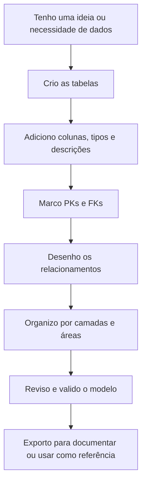
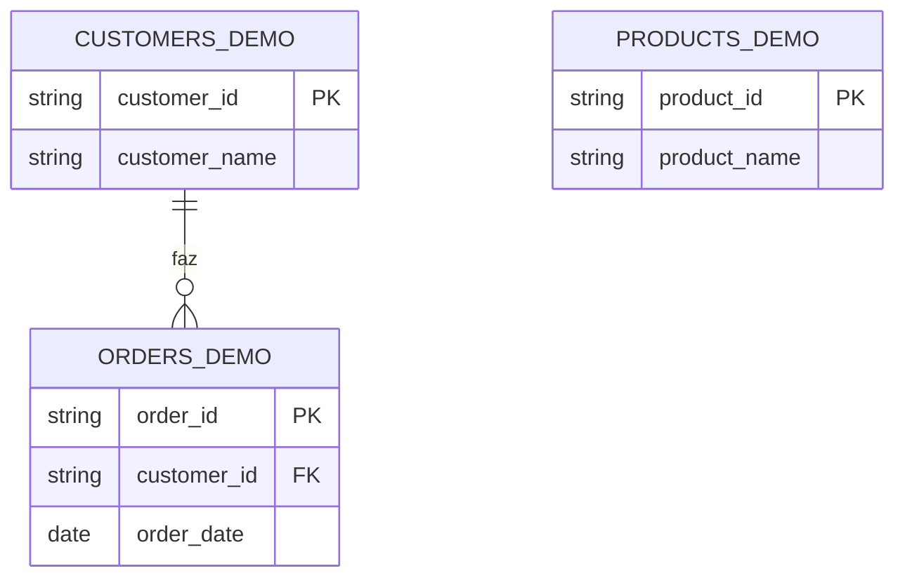
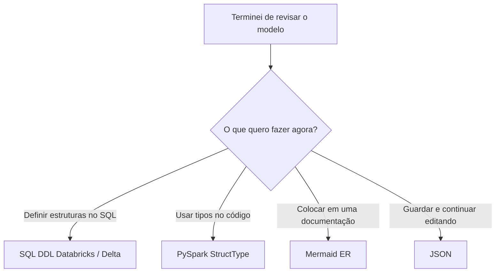

# Data Modeling

**Uma ferramenta visual que eu criei para desenhar, organizar e explicar modelos de dados.**

Quando a gente trabalha com dados, é comum ter várias tabelas, colunas e relacionamentos que precisam fazer sentido juntos. O problema é que, quando essas informações ficam espalhadas em arquivos, planilhas e trechos de SQL, nem sempre é fácil enxergar a estrutura completa.

O **Data Modeling** nasceu para resolver essa parte: reunir tudo em um único quadro visual. Nele, eu consigo montar tabelas, definir suas colunas, marcar chaves, mostrar como elas se relacionam e separar o modelo por camadas. Também posso acrescentar notas e explicações para que outra pessoa entenda o desenho sem precisar conhecer todo o contexto.

A ferramenta pode ajudar quem está aprendendo modelagem de dados, quem trabalha com engenharia de dados e quem precisa planejar ou explicar uma estrutura antes de implementá-la.

> **Em poucas palavras:** o Data Modeling ajuda a desenhar e documentar a estrutura dos dados. Ele não consulta os registros nem executa transformações nesta versão.

---

## 1. Entenda a ideia

Pense no Data Modeling como um quadro branco feito para organizar modelos de dados.

Em vez de explicar uma estrutura apenas por texto, você monta um desenho com tabelas e ligações. Cada tabela mostra suas colunas, tipos e chaves. As linhas entre elas mostram os relacionamentos. As áreas e notas ajudam a separar assuntos e registrar decisões.



## 2. Como é a área de trabalho

A imagem abaixo é uma representação simplificada para ajudar a entender a organização da ferramenta. Não é uma captura literal da tela.

```text
┌──────────────────────────────────────────────────────────────────────┐
│ DATA MODELING                 Quadro / Busca / Zoom / Opções          │
├───────────────┬──────────────────────────────────────┬───────────────┤
│ FERRAMENTAS   │                                      │ PROPRIEDADES  │
│               │          ÁREA DE MODELAGEM           │               │
│ Tabela        │                                      │ Nome da tabela│
│ Relacionamento│   ┌────────────────┐                 │ Colunas       │
│ Nota          │   │ customers_demo │                 │ Tipos         │
│ Texto         │   │----------------│                 │ PK / FK       │
│ Área / forma  │   │ PK customer_id │                 │ Descrição     │
│ Conector      │   │ name           │                 │               │
│               │   └───────┬────────┘                 │               │
│               │           │ 1                        │               │
│               │           │                          │               │
│               │   ┌───────▼────────┐                 │               │
│               │   │ orders_demo    │                 │               │
│               │   │----------------│                 │               │
│               │   │ PK order_id    │                 │               │
│               │   │ FK customer_id │                 │               │
│               │   └────────────────┘                 │               │
├───────────────┴──────────────────────────────────────┴───────────────┤
│ Grade · Minimapa · Validação · Desfazer/Refazer · Importar/Exportar  │
└──────────────────────────────────────────────────────────────────────┘
```

Na prática, você organiza os elementos diretamente no quadro, seleciona o que quer editar e ajusta as propriedades. Os recursos de busca, zoom, grade e minimapa ajudam quando o modelo começa a ficar maior.

## 3. O que eu consigo fazer com ele hoje

| Recurso | Para que serve |
|---|---|
| Criar tabelas e colunas | Representar as estruturas que fazem parte do modelo. |
| Definir tipos e descrições | Explicar que informação cada coluna guarda. |
| Marcar PK e FK | Mostrar como os registros são identificados e relacionados. |
| Criar relacionamentos | Desenhar as ligações entre tabelas e indicar a cardinalidade. |
| Organizar por camadas | Separar elementos em `raw`, `bronze`, `silver`, `gold`, `stage`, `dim`, `fact` e entidade. |
| Usar áreas, notas e formas | Separar partes do desenho e registrar regras ou decisões. |
| Revisar o quadro | Usar validação, busca, minimapa, zoom, grade, seleção e desfazer/refazer. |
| Importar e exportar | Trabalhar com DDL e JSON e exportar o modelo em formatos técnicos. |

Também é possível exportar o modelo em quatro formatos:

- **SQL DDL Databricks / Delta:** gera instruções para definir estruturas de tabelas.
- **PySpark `StructType`:** representa campos e tipos para usar no código PySpark.
- **Mermaid ER:** cria um diagrama textual que pode ser incluído em documentação compatível.
- **JSON:** guarda a estrutura do quadro para importar novamente.

O SQL gerado é DDL, ou seja, definição de estrutura. Ele não é um `SELECT`, não executa JOINs e não transforma registros.

## 4. Um exemplo simples

Imagine que eu queira desenhar uma estrutura fictícia de vendas. Posso começar com três tabelas:

| Tabela | O que representa | Exemplo de chave |
|---|---|---|
| `customers_demo` | Cadastro de clientes de demonstração | `customer_id` |
| `orders_demo` | Pedidos de demonstração | `order_id` |
| `products_demo` | Produtos de demonstração | `product_id` |

O relacionamento entre clientes e pedidos pode ser representado assim:



Esse desenho mostra a estrutura e a regra de relacionamento que eu quero documentar. Ele não contém registros reais e não executa uma consulta.

## 5. Como tirar melhor proveito

Minha recomendação é não começar desenhando tudo de uma vez. É melhor montar o modelo por etapas:

1. **Defina o objetivo.** Escreva o que você quer representar e por que esse modelo está sendo criado.
2. **Liste as tabelas.** Comece pelos assuntos principais, sem tentar detalhar tudo no primeiro momento.
3. **Defina o grão.** Para cada tabela, deixe claro o que uma linha representa: um cliente, um pedido, um produto ou um item de pedido, por exemplo.
4. **Adicione as colunas.** Informe nome, tipo de dado e uma descrição que qualquer pessoa consiga entender.
5. **Marque as chaves.** Use PK para identificar o registro e FK para mostrar a referência a outra tabela.
6. **Desenhe as relações.** Confira se a cardinalidade representa a regra real do cenário.
7. **Organize o quadro.** Agrupe tabelas relacionadas, separe camadas e use notas para explicar decisões.
8. **Valide e revise.** Leia o modelo como se fosse outra pessoa que nunca viu aquele projeto.
9. **Exporte o que precisa.** Escolha DDL, PySpark, Mermaid ou JSON de acordo com o próximo passo.

Uma boa prática é registrar dúvidas no próprio quadro. Se uma regra ainda não foi confirmada, escreva isso em uma nota em vez de assumir que está correta.

## 6. Qual formato devo exportar?



| Se você precisa... | Escolha |
|---|---|
| De uma definição de tabelas | SQL DDL |
| De um schema para PySpark | `StructType` |
| De um diagrama em Markdown compatível | Mermaid ER |
| De guardar o quadro para importar depois | JSON |

Revise qualquer SQL exportado antes de executar em outro ambiente. A exportação não substitui uma revisão técnica.

## 7. Como abrir

1. Baixe o projeto ou clone o repositório.
2. Abra `app/index.html` em um navegador moderno.
3. Crie um quadro e comece a adicionar tabelas e relacionamentos.
4. Quando terminar, use as opções de exportação disponíveis na aplicação.

### Atenção ao salvamento

Quando o HTML é aberto diretamente em um navegador, sem o ambiente hospedeiro compatível, a ferramenta funciona em modo local. Nesse modo, não existe armazenamento compartilhado nem garantia de salvamento automático. Exporte o JSON para guardar uma cópia do quadro e importe esse arquivo quando quiser continuar.

A aplicação também reconhece um ambiente hospedeiro que disponibilize `window.claude` e os serviços necessários (`db`, `user`, `room` e `downloads`). Nesse caso, recursos como identidade, presença e sincronização dependem da implementação e da configuração desse ambiente. Abrir o arquivo em qualquer navegador não ativa esses recursos automaticamente.

## 8. A Skill incluída no projeto

Além da aplicação, este repositório inclui uma Skill chamada `data-modeling`. Ela orienta um agente de IA a instalar a ferramenta, explicar seus recursos e ajudar a pessoa a montar um modelo com boas práticas.

Para instalar o aplicativo a partir da Skill, execute:

```bash
python skill/data-modeling/Scripts/install.py --target ./data-modeling
```

O instalador copia o HTML, um exemplo fictício e um README para a pasta indicada. A Skill não substitui o aplicativo: ela ajuda o agente a orientar o uso dele.

## 9. O que ainda não faz parte do projeto

Quero deixar claro o que está pronto e o que ainda é uma ideia para o futuro. Nesta versão, o Data Modeling **não**:

- executa JOINs sobre registros;
- mostra uma prévia das linhas resultantes de um JOIN;
- cria tabelas finais a partir de transformações;
- executa SQL ou pipelines no Databricks;
- conecta diretamente a um workspace ou warehouse Databricks;
- calcula automaticamente a linhagem de dados ou de colunas.

A ideia de criar um construtor visual de JOINs, gerar SQL de transformação, mostrar prévias com dados fictícios e representar linhagem está no roadmap. Esses recursos só devem ser considerados disponíveis quando forem implementados e testados em uma versão futura.

## 10. Organização dos arquivos

```text
data-modeling/
├── app/
│   └── index.html
├── docs/
│   ├── ARCHITECTURE.md
│   ├── GUIA_DE_USO.md
│   ├── PRODUCT.md
│   ├── ROADMAP.md
│   └── SECURITY_MODEL.md
├── examples/
│   └── sample-project.json
├── skill/
│   ├── README.md
│   └── data-modeling/
│       ├── SKILL.md
│       ├── Assets/
│       ├── References/
│       └── Scripts/
└── tests/
```

- `app/` contém a aplicação que abre no navegador.
- `docs/` reúne a explicação do projeto e o guia de uso.
- `examples/` tem um modelo fictício para demonstração.
- `skill/` contém as instruções para um agente de IA e o instalador.
- `tests/` contém verificações automatizadas do projeto.

## 11. Segurança e privacidade

Mesmo sem guardar registros reais, um modelo pode revelar nomes de tabelas, colunas, regras de negócio e detalhes de uma arquitetura. Por isso, use dados fictícios nos exemplos públicos e não coloque senhas, tokens, chaves de API ou informações internas no quadro.

Antes de compartilhar um JSON, confira o conteúdo. Ele pode incluir nomes de tabelas, colunas, notas, descrições e decisões de arquitetura.

No modo integrado, a proteção também depende do ambiente hospedeiro, das permissões, da identidade dos usuários e da gestão das chaves. A criptografia presente no código é uma camada da solução, não uma garantia isolada de segurança.

## 12. Documentação complementar

- [Guia prático de uso](docs/GUIA_DE_USO.md)
- [Como a aplicação funciona](docs/ARCHITECTURE.md)
- [Objetivo e escopo do projeto](docs/PRODUCT.md)
- [Ideias para próximas versões](docs/ROADMAP.md)
- [Segurança e privacidade](docs/SECURITY_MODEL.md)
- [Licença Apache-2.0](LICENSE)
