<h1 align="center">Data Modeling</h1>

<p align="center">
  <b>Quadro visual para desenhar, documentar e exportar modelos de dados — direto no Claude ou no Codex.</b><br>
  Tabelas, colunas, PK/FK, relacionamentos, camadas bronze/silver/gold, notas e fluxos num só lugar,<br>
  com exportação para <b>SQL DDL Databricks/Delta</b>, <b>PySpark StructType</b>, <b>Mermaid ER</b> e <b>JSON</b>.
</p>

<p align="center">
  <a href="https://github.com/carlos-dataengineer/data-modeling/actions/workflows/ci.yml"></a>
  <a href="https://github.com/carlos-dataengineer/data-modeling/releases"></a>
  <a href="LICENSE"></a>
  
</p>

<p align="center">
  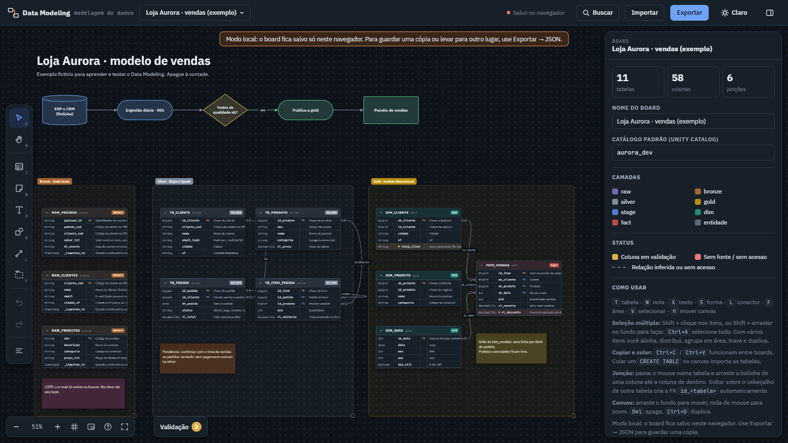
</p>

> **Instale com um comando e a ferramenta é gerada automaticamente.** O instalador coloca a skill no Claude Code e no Codex e já cria o app pronto no seu computador. No Claude, basta pedir *"abrir o Data Modeling"*: ele publica o artefato na sua conta, com seus boards salvos e compartilháveis.

---

## Sumário

- [Instalar em um comando](#instalar-em-um-comando)
- [O que acontece quando você instala](#o-que-acontece-quando-você-instala)
- [Como usar no Claude, no Codex e no navegador](#como-usar-no-claude-no-codex-e-no-navegador)
- [O que é e para quem é](#o-que-é-e-para-quem-é)
- [Casos de uso](#casos-de-uso)
- [Tour pelas telas](#tour-pelas-telas)
- [Seu primeiro modelo em 5 minutos](#seu-primeiro-modelo-em-5-minutos)
- [Atalhos de teclado](#atalhos-de-teclado)
- [Camadas, status e validação](#camadas-status-e-validação)
- [Importar e exportar](#importar-e-exportar)
- [O exemplo Loja Aurora](#o-exemplo-loja-aurora)
- [Onde ficam os dados](#onde-ficam-os-dados)
- [Pedidos prontos para o agente](#pedidos-prontos-para-o-agente)
- [Opções do instalador, atualizar e desinstalar](#opções-do-instalador-atualizar-e-desinstalar)
- [O que ele não faz](#o-que-ele-não-faz)
- [Estrutura do repositório](#estrutura-do-repositório)
- [Contribuir, segurança e licença](#contribuir-segurança-e-licença)

---

## Instalar em um comando

**Windows (PowerShell)**

```powershell
irm https://raw.githubusercontent.com/carlos-dataengineer/data-modeling/main/install.ps1 | iex
```

**macOS e Linux**

```bash
curl -fsSL https://raw.githubusercontent.com/carlos-dataengineer/data-modeling/main/install.sh | bash
```

Requisitos: um navegador moderno. Nada mais — sem Node, sem Python, sem banco de dados. Depois de instalar, **abra uma nova conversa** no Claude Code ou no Codex para o agente reconhecer a skill.

<details>
<summary>Prefere instalar a partir de um clone, ou como plugin do Claude Code?</summary>

```bash
git clone https://github.com/carlos-dataengineer/data-modeling.git
cd data-modeling
./install.sh            # macOS/Linux
.\install.ps1           # Windows
```

Como plugin (marketplace) do Claude Code:

```text
/plugin marketplace add carlos-dataengineer/data-modeling
/plugin install data-modeling@data-modeling
```

O plugin instala só a skill. O app local (`~/DataModeling/data-modeling.html`) é criado pelo instalador ou pela própria skill na primeira vez que você pedir para abrir.

</details>

## O que acontece quando você instala

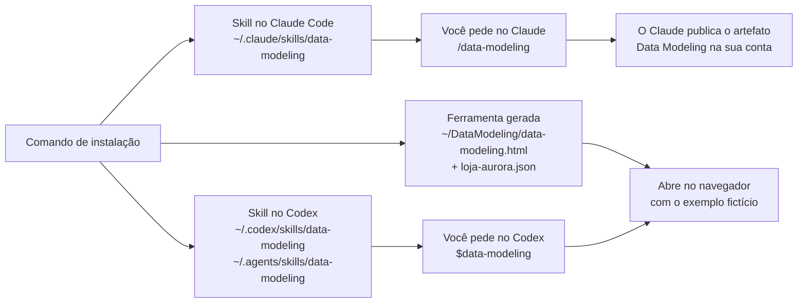

| Etapa | O que o instalador faz |
|---|---|
| 1. Baixa | Pega a versão mais recente do GitHub (ou usa a pasta local, se você rodou de um clone). |
| 2. Skill | Copia a skill `data-modeling` para o **Claude Code** e para o **Codex**. Se já existir uma pasta com esse nome que não seja do Data Modeling, ela é preservada e o passo é pulado. |
| 3. Ferramenta | **Gera** `~/DataModeling/data-modeling.html` (app completo, num arquivo só) e `loja-aurora.json` (exemplo) e abre no navegador. |
| 4. Próximos passos | Mostra como chamar a ferramenta em cada agente. |

A partir daí, a ferramenta aparece sozinha onde você trabalha:

- **No Claude** (app desktop, Claude Code ou claude.ai com artefatos): ao pedir *"abrir o Data Modeling"* ou digitar `/data-modeling`, o Claude **gera o artefato Data Modeling** na sua conta. Os boards ficam salvos, você pode compartilhar o link, ver quem está no board e exportar arquivos. Se o artefato já existir, ele oferece abrir o mesmo em vez de duplicar.
- **No Codex**: ao pedir *"abra o Data Modeling"* ou digitar `$data-modeling`, ele abre a ferramenta gerada no navegador.
- **Sem agente nenhum**: dê dois cliques em `~/DataModeling/data-modeling.html`.

## Como usar no Claude, no Codex e no navegador

| Onde | Como chamar | Onde o board fica salvo | Colaboração |
|---|---|---|---|
| **Claude** (artefato) | `/data-modeling` ou *"abre o Data Modeling"* | Na sua conta do Claude, criptografado | Sim: link compartilhável, presença ao vivo, acesso aprovado pelo dono |
| **Codex** | `$data-modeling` ou *"abra o Data Modeling"* | No navegador (`localStorage`) | Não — exporte o JSON para enviar |
| **Navegador** | Abrir `~/DataModeling/data-modeling.html` | No navegador (`localStorage`) | Não — exporte o JSON para enviar |

Você também pode pedir ao agente um **modelo já desenhado** (veja [Pedidos prontos para o agente](#pedidos-prontos-para-o-agente)).

## O que é e para quem é

O Data Modeling é um quadro branco feito para modelagem de dados. Em vez de explicar uma estrutura só com texto, SQL solto ou planilha, você desenha as tabelas, marca as chaves, liga as colunas e organiza tudo em camadas — e o desenho vira DDL, schema PySpark ou diagrama Mermaid com um clique.

Ele é útil para:

- **Engenheiras e engenheiros de dados** que planejam tabelas de um pipeline (bronze → silver → gold) antes de escrever código.
- **Analytics engineers** que desenham modelos dimensionais (fato e dimensões) e querem DDL e documentação coerentes.
- **Quem está aprendendo modelagem** e quer enxergar grão, PK, FK e cardinalidade na prática.
- **Times** que precisam revisar uma arquitetura juntos e registrar dúvidas no próprio desenho.
- **Quem documenta** um banco existente: cole os `CREATE TABLE` e o diagrama aparece.

## Casos de uso

| Caso | Como o Data Modeling ajuda |
|---|---|
| **Desenhar a arquitetura medalhão** de um pipeline | Uma área por camada, tabelas coloridas por camada e um fluxo (ingestão → testes → publicação) com formas e conectores. |
| **Modelo dimensional** para BI | Fato no centro, dimensões ao redor, chaves `sk_` ligadas com cardinalidade `1 → 0..N`; exporte o DDL do Unity Catalog. |
| **Documentar um banco que já existe** | Importe vários `CREATE TABLE` (Databricks, Spark SQL, Oracle, Postgres): colunas, `COMMENT`, `NOT NULL`, PK e FK viram tabelas e junções. |
| **Revisão com o time** | Notas para pendências, colunas marcadas como *em validação* ou *sem fonte*, painel de observações do time e presença ao vivo no artefato. |
| **Gerar schema para PySpark** | Exporte `StructType` pronto para colar no notebook. |
| **Documentação em Markdown** | Exporte Mermaid ER e cole no README, na wiki ou no Confluence. |
| **Ensinar modelagem** | Abra o exemplo Loja Aurora e mostre grão, chaves, camadas e as regras de LGPD anotadas no próprio quadro. |

## Tour pelas telas

Todas as imagens usam o exemplo **fictício** Loja Aurora, que vem embutido no app.

### Visão geral: canvas, barra de ferramentas e painel do board


- **Topo:** nome do board (menu para trocar de board no artefato), indicador de salvamento, **Buscar**, **Importar**, **Exportar**, tema claro/escuro e o botão que mostra ou esconde o painel lateral.
- **Esquerda:** ferramentas — selecionar (`V`), mover o canvas (`H`), tabela (`T`), nota (`N`), texto (`X`), formas (`S`), conector (`L`), área (`F`) — e desfazer, refazer e modo compacto.
- **Direita:** com nada selecionado, o painel mostra o resumo do board (tabelas, colunas, junções), nome, catálogo padrão do Unity Catalog, legenda de camadas e status e um guia rápido.
- **Rodapé:** zoom, grade, minimapa, atalhos (`?`), enquadrar tudo e o botão **Validação** com a contagem de alertas.

### Editar uma tabela

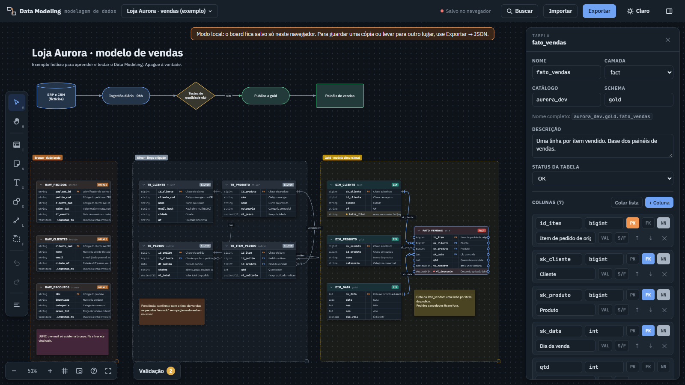

Clique no cabeçalho de uma tabela para editar **nome, camada, catálogo, schema, descrição e status**. Na lista de colunas você define nome, tipo, descrição e liga **PK**, **FK** e **NN** (NOT NULL), marca a coluna como **VAL** (em validação) ou **S/F** (sem fonte), reordena e remove. **Colar lista** cria várias colunas de uma vez (`nome tipo descrição`, uma por linha). As junções da tabela ficam destacadas no canvas.

### Colunas, chaves e cardinalidade de perto

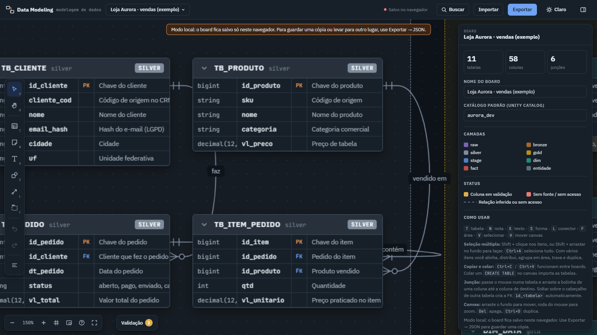

Cada linha mostra tipo, nome, selo **PK/FK** e descrição. As linhas entre tabelas saem da coluna de origem e chegam na coluna de destino, com a notação de cardinalidade (pé de galinha) e um rótulo opcional (*faz*, *contém*, *vendido em*). Para criar uma junção, passe o mouse na tabela e **arraste a bolinha ao lado de uma coluna até a coluna de destino**; soltar no **cabeçalho** de outra tabela cria a FK `id_<tabela>` automaticamente. Clique na junção para trocar cardinalidade, rótulo, direção ou copiar o `JOIN` em SQL.

### Seleção múltipla: alinhar, distribuir e agrupar

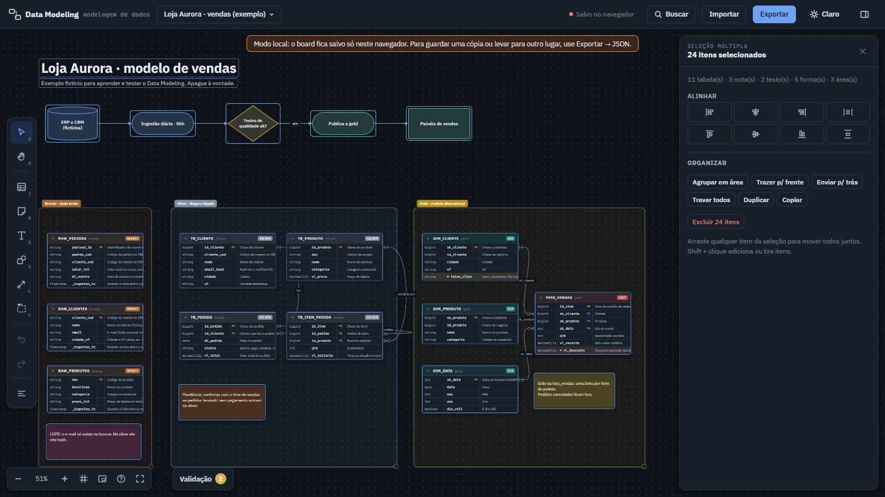

`Shift` + clique ou `Shift` + arrastar no fundo (laço) seleciona vários itens; `Ctrl+A` seleciona tudo. O painel passa a oferecer alinhar, distribuir, **agrupar em área**, trazer para frente, enviar para trás, travar, duplicar, copiar e excluir.

### Validação do modelo

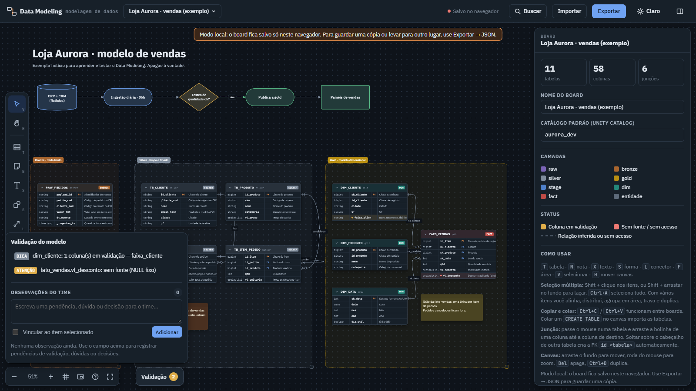

O botão **Validação** lista, ao vivo: tabela sem PK ou sem colunas, nome fora de `snake_case`, coluna sem nome ou duplicada, FK sem relacionamento, junção com tipos diferentes, relação apontando para coluna removida, colunas *em validação* e *sem fonte*. Clique num alerta para ir até o item. Abaixo ficam as **observações do time**, que podem ser vinculadas ao item selecionado.

### Busca

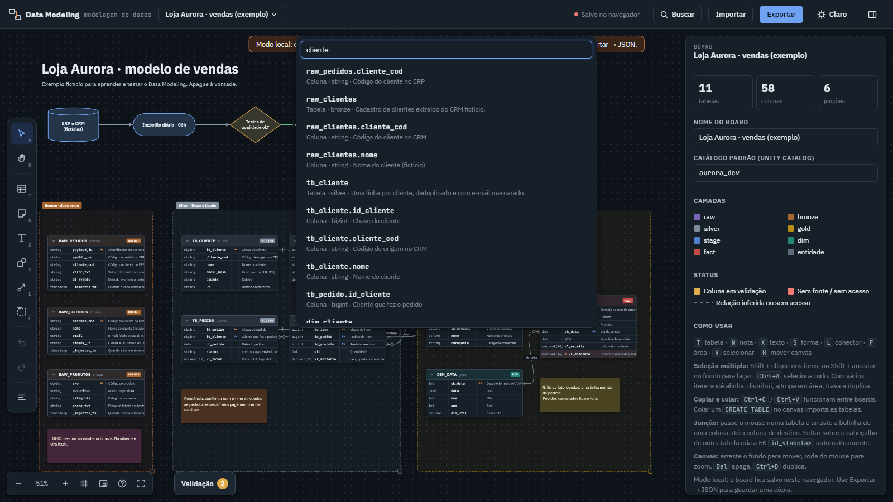

`Ctrl+K` busca tabelas, colunas, notas, textos, formas e áreas. `Enter` vai ao primeiro resultado.

### Minimapa e grade

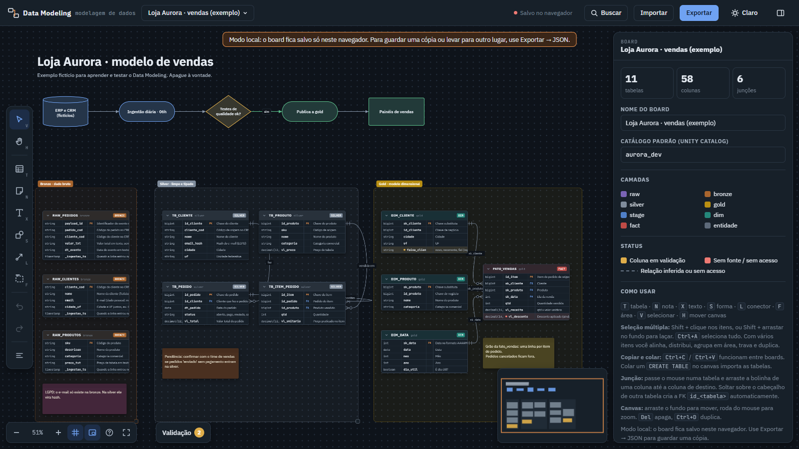

`M` liga o minimapa (clique ou arraste nele para navegar) e `G` faz tudo encaixar na grade. `Shift+1` enquadra o board inteiro.

### Exportar: SQL DDL, PySpark e Mermaid

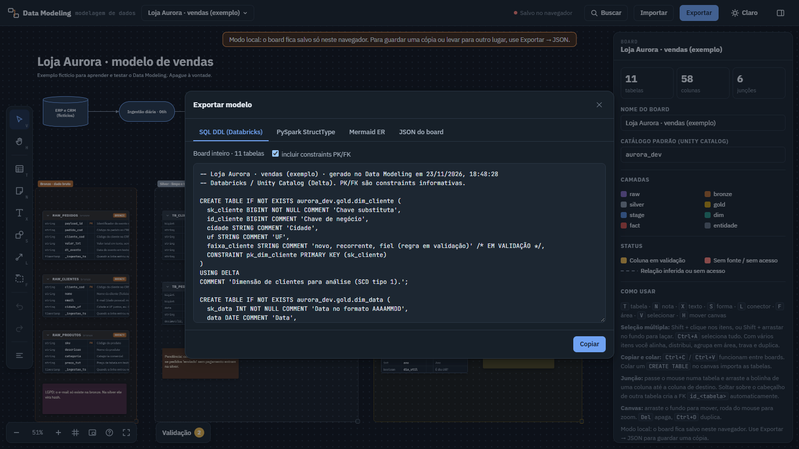

<table>
  <tr>
    <td width="50%">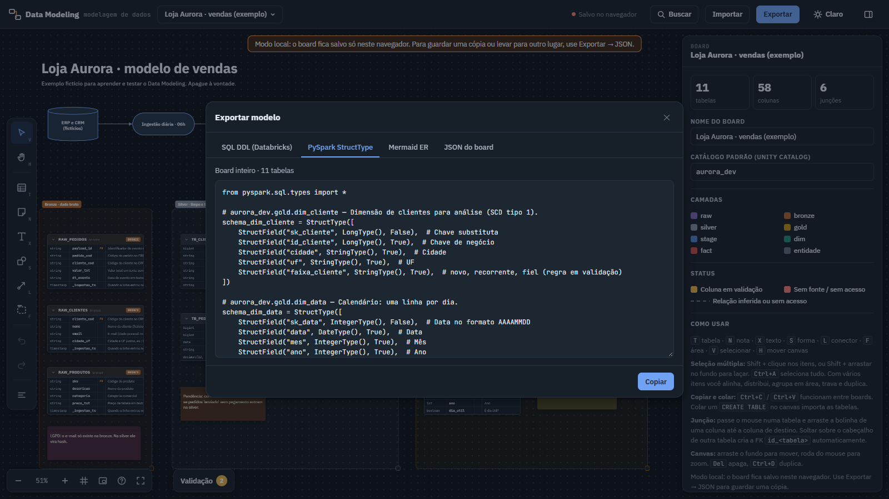</td>
    <td width="50%">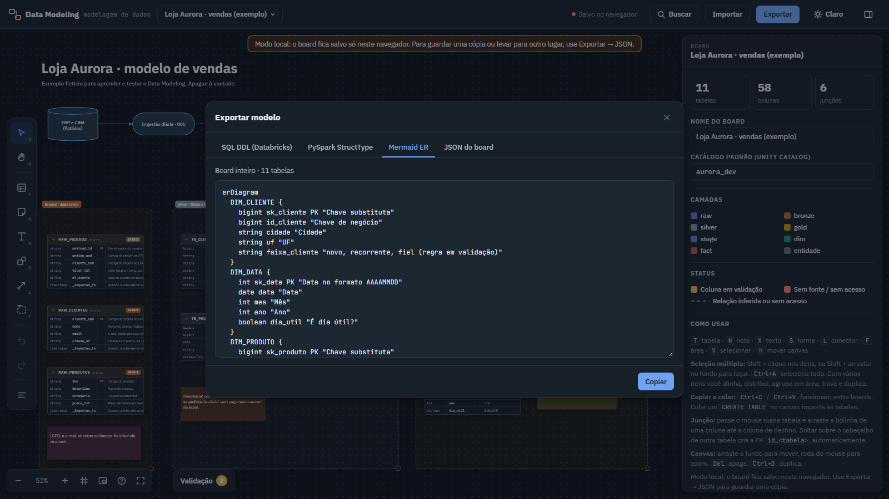</td>
  </tr>
</table>

O DDL sai na ordem certa (dimensões antes da fato), com `COMMENT` nas colunas e tabelas, `USING DELTA` e, se você quiser, constraints PK/FK informativas do Unity Catalog. Colunas *em validação* ganham um comentário `/* EM VALIDAÇÃO */`. Dá para exportar só as tabelas selecionadas.

### Importar um `CREATE TABLE`

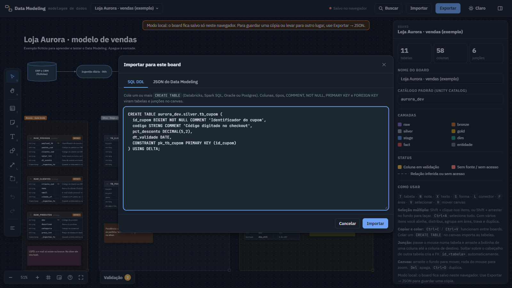

Cole um ou vários `CREATE TABLE` e as tabelas aparecem no canvas, com camada deduzida pelo schema (`bronze`, `silver`, `gold`…). Também funciona colando o DDL direto no canvas com `Ctrl+V`. A aba **JSON do Data Modeling** importa um board exportado (as tabelas entram como cópias).

### Atalhos na tela

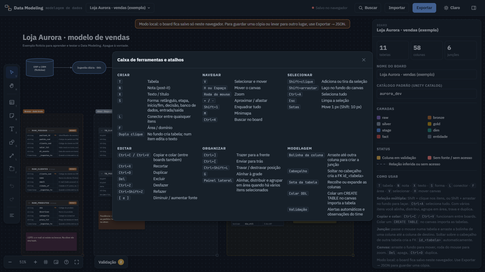

### Tema claro e celular

<table>
  <tr>
    <td width="72%">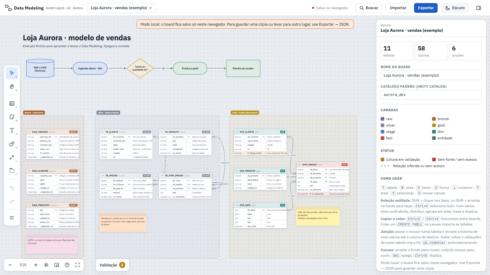</td>
    <td width="28%">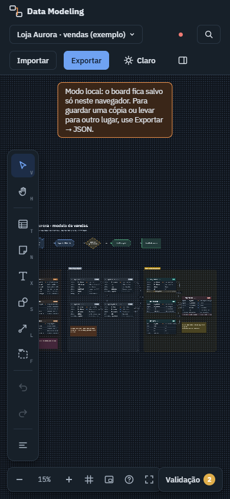</td>
  </tr>
</table>

O tema alterna no botão **Claro/Escuro**. No celular, a barra superior se reorganiza, o painel lateral abre e fecha pelo botão do topo e o canvas aceita gesto de pinça para zoom.

## Seu primeiro modelo em 5 minutos

1. **Abra a ferramenta** (`/data-modeling` no Claude, `$data-modeling` no Codex ou o arquivo `~/DataModeling/data-modeling.html`). No artefato, crie um board em **Novo board**.
2. **Dê nome ao board e ao catálogo** no painel da direita (ex.: `aurora_dev`). O catálogo entra no nome completo das tabelas no DDL.
3. **Crie as tabelas:** aperte `T` e clique no canvas (ou dê duplo clique no fundo). Defina nome, camada e, na descrição, o **grão** — o que uma linha representa.
4. **Adicione colunas** com **+ Coluna** ou **Colar lista**, marcando **PK** e **NN**.
5. **Ligue as tabelas:** arraste a bolinha da coluna `id_cliente` de uma tabela até a coluna correspondente na outra. A coluna de destino vira **FK** e a cardinalidade padrão é `1 → 0..N`.
6. **Organize:** `F` cria uma área por camada; `N` deixa uma nota com dúvidas; `S` e `L` desenham o fluxo do pipeline.
7. **Valide:** abra **Validação** e resolva os alertas.
8. **Exporte:** **Exportar → SQL DDL**, **PySpark**, **Mermaid** ou **JSON**.

Quer ver um modelo pronto antes? Clique em **Carregar exemplo** (no board vazio ou no painel do board).

## Atalhos de teclado

| Criar | | Navegar | |
|---|---|---|---|
| `T` | Tabela | `V` | Selecionar e mover |
| `N` | Nota (post-it) | `H` ou `Espaço` | Mover o canvas |
| `X` | Texto / título | Roda do mouse | Zoom |
| `S` | Forma: retângulo, etapa, início/fim, decisão, banco de dados, entrada/saída | `+` / `−` | Aproximar / afastar |
| `L` | Conector entre quaisquer itens | `Shift+1` | Enquadrar tudo |
| `F` | Área / domínio | `M` | Minimapa |
| Duplo clique | No fundo cria tabela; num item edita o texto | `Ctrl+K` | Buscar no board |

| Selecionar | | Editar | |
|---|---|---|---|
| `Shift`+clique | Adiciona ou tira da seleção | `Ctrl+C` / `Ctrl+V` | Copiar e colar (entre boards também) |
| `Shift`+arrastar | Laço no fundo do canvas | `Ctrl+X` | Recortar |
| `Ctrl+A` | Seleciona tudo | `Ctrl+D` | Duplicar |
| `Esc` | Limpa a seleção | `Del` | Excluir |
| Setas | Move 1 px (`Shift`: 10 px) | `Ctrl+Z` / `Ctrl+Shift+Z` | Desfazer / refazer |
| | | `[` e `]` | Diminuir / aumentar fonte |

| Organizar | | Modelagem | |
|---|---|---|---|
| `Ctrl+]` | Trazer para a frente | Bolinha da coluna | Arraste até outra coluna para criar a junção |
| `Ctrl+[` | Enviar para trás | Cabeçalho | Soltar no cabeçalho cria a FK `id_<tabela>` |
| `Ctrl+Shift+L` | Travar / destravar posição | Seta da tabela | Recolhe ou expande as colunas |
| `G` | Alinhar à grade | Colar DDL | Colar um `CREATE TABLE` no canvas importa a tabela |
| `?` | Mostra esta lista na tela | Validação | Alertas automáticos e observações do time |

No macOS, use `Cmd` no lugar de `Ctrl`.

## Camadas, status e validação

| Camada | Cor | Uso típico |
|---|---|---|
| `raw` | roxo | Arquivo ou evento exatamente como chegou |
| `bronze` | cobre | Cópia fiel da origem, com metadados de ingestão |
| `silver` | cinza | Limpo, tipado, deduplicado, com dados pessoais mascarados |
| `gold` | dourado | Pronto para consumo |
| `stage` | azul | Tabelas intermediárias de transformação |
| `dim` | verde | Dimensões do modelo dimensional |
| `fact` | vermelho | Fatos (eventos e métricas) |
| `entidade` | cinza-azulado | Qualquer outra entidade |

**Status de coluna:** *em validação* (amarelo) para regra ainda não confirmada e *sem fonte* (vermelho) para coluna planejada sem origem definida. **Status de tabela:** *sem acesso* para tabelas que existem mas você ainda não consegue ler. Linhas tracejadas indicam relação inferida ou sem acesso.

## Importar e exportar

| Formato | Importa | Exporta | Para quê |
|---|:-:|:-:|---|
| SQL DDL (Databricks / Spark SQL / Oracle / Postgres) | ✅ | ✅ Databricks/Delta | Criar ou documentar estruturas no Unity Catalog |
| PySpark `StructType` | — | ✅ | Schema explícito no notebook |
| Mermaid ER | — | ✅ | Diagrama em Markdown (GitHub, wikis) |
| JSON do Data Modeling | ✅ | ✅ | Guardar, versionar no git, enviar para outra pessoa, levar entre Claude e Codex |

No artefato do Claude, a exportação tem o botão **Baixar**; no navegador, use **Copiar**. O DDL gerado **define estruturas** — não é consulta nem transformação. Revise antes de rodar em qualquer ambiente.

O formato do JSON está documentado em [skills/data-modeling/references/FORMATO-JSON.md](skills/data-modeling/references/FORMATO-JSON.md).

## O exemplo Loja Aurora

Um e-commerce **fictício** criado para mostrar o que a ferramenta faz. Nenhum dado é real.

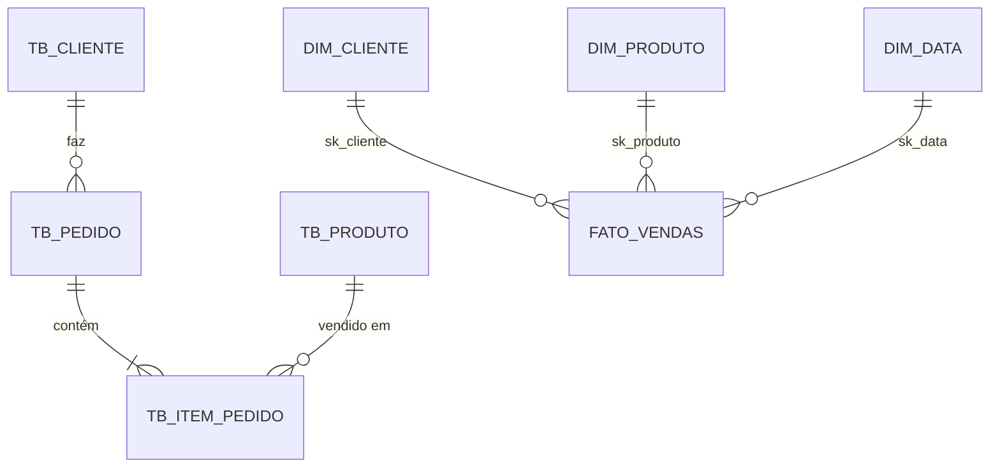

- **Bronze:** `raw_pedidos`, `raw_clientes`, `raw_produtos` — como chegam do ERP e do CRM, com `_ingestao_ts`.
- **Silver:** `tb_cliente`, `tb_pedido`, `tb_produto`, `tb_item_pedido` — limpos e tipados; o e-mail vira hash (nota de LGPD).
- **Gold:** `dim_cliente`, `dim_produto`, `dim_data` e `fato_vendas` (grão: um item de pedido).
- **Fluxo:** ERP/CRM → ingestão diária → testes de qualidade → publica a gold → painéis.
- **Dois alertas de propósito** para você ver a validação funcionando: `faixa_cliente` em validação e `vl_desconto` sem fonte.

Arquivo: [examples/loja-aurora.json](examples/loja-aurora.json).

## Onde ficam os dados

**No artefato do Claude**
- Os boards ficam no armazenamento do artefato, na sua conta, **criptografados no navegador** (AES-GCM via Web Crypto).
- Quem recebe o link só vê os projetos **depois que o dono aprova o acesso**. O dono vê pedidos de acesso, aprova e revoga — revogar troca a chave de todos os projetos.
- Vários boards por artefato, presença de quem está no board e cursores ao vivo.

**No navegador (Codex ou arquivo local)**
- O board fica salvo no `localStorage` daquele navegador. Fechar e abrir de novo mantém o trabalho.
- Limpar os dados do navegador ou trocar de computador apaga o board: use **Exportar → JSON** para guardar uma cópia.
- Nada é enviado a servidores. A única requisição externa é a das fontes (Google Fonts).

Em qualquer modo: não coloque senhas, tokens, dados pessoais ou amostras reais no quadro. Mesmo sem registros, um modelo revela nomes de tabelas, colunas e regras de negócio — revise o JSON antes de compartilhar. Mais em [docs/SECURITY_MODEL.md](docs/SECURITY_MODEL.md).

## Pedidos prontos para o agente

Depois de instalar, experimente no Claude ou no Codex:

- *"Abre o Data Modeling."*
- *"Abre o Data Modeling com o exemplo da Loja Aurora e me explica o que é grão."*
- *"Transforma estes CREATE TABLE num diagrama no Data Modeling:"* (e cole o DDL)
- *"Desenha no Data Modeling um modelo dimensional para vendas de uma academia fictícia: fato de check-ins, dimensões aluno, unidade e data."*
- *"Revisa meu modelo: o que está faltando de PK, FK e grão?"* (e cole o JSON exportado)
- *"Gera o StructType da tabela fato_vendas."*

A skill sabe abrir a ferramenta certa em cada ambiente, entregar modelos já desenhados e explicar os recursos sem inventar funções que não existem.

## Opções do instalador, atualizar e desinstalar

| Windows (`install.ps1`) | macOS/Linux (`install.sh`) | Variável de ambiente | Efeito |
|---|---|---|---|
| `-NoOpen` | `--no-open` | `DATA_MODELING_NO_OPEN=1` | Não abre o navegador no fim |
| `-SkipClaude` | `--skip-claude` | `DATA_MODELING_SKIP_CLAUDE=1` | Não instala no Claude Code |
| `-SkipCodex` | `--skip-codex` | `DATA_MODELING_SKIP_CODEX=1` | Não instala no Codex |
| `-Ref v2.0.0` | `--ref v2.0.0` | `DATA_MODELING_REF=v2.0.0` | Instala uma versão (tag) ou branch específica |

Com `irm | iex` use as variáveis de ambiente, por exemplo:

```powershell
$env:DATA_MODELING_SKIP_CODEX = '1'; irm https://raw.githubusercontent.com/carlos-dataengineer/data-modeling/main/install.ps1 | iex
```

O instalador respeita `CODEX_HOME`. **Atualizar** = rodar o mesmo comando de novo (a skill é substituída; seus boards não são tocados).

**Desinstalar** (remove só pastas cuja skill se chama `data-modeling`; `-All`/`--all` também apaga `~/DataModeling`):

```powershell
irm https://raw.githubusercontent.com/carlos-dataengineer/data-modeling/main/uninstall.ps1 | iex
```

```bash
curl -fsSL https://raw.githubusercontent.com/carlos-dataengineer/data-modeling/main/uninstall.sh | bash
```

Os boards salvos no navegador e os artefatos no Claude continuam onde estão.

## O que ele não faz

O Data Modeling desenha e documenta a **estrutura**. Nesta versão ele não executa SQL nem pipelines, não consulta registros, não mostra prévia de JOINs, não cria tabelas derivadas, não se conecta ao Databricks e não calcula linhagem automaticamente. Construtor visual de JOINs e linhagem estão no [roadmap](docs/ROADMAP.md).

## Estrutura do repositório

```text
data-modeling/
├── install.ps1 · install.sh          instaladores de um comando
├── uninstall.ps1 · uninstall.sh
├── src/data-modeling.html            fonte do app (edite aqui)
├── examples/loja-aurora.json         exemplo fictício (embutido no app no build)
├── app/index.html                    app pronto para abrir no navegador (gerado)
├── skills/data-modeling/             skill para Claude Code e Codex
│   ├── SKILL.md
│   ├── agents/openai.yaml            metadados para o Codex
│   ├── assets/                       app completo, fragmento do artefato e exemplo (gerados)
│   └── references/                   formato JSON e roteiro de modelagem
├── .claude-plugin/                   plugin e marketplace do Claude Code
├── scripts/build.py                  gera app/ e skills/…/assets a partir de src/
├── scripts/screenshots.py            gera as imagens deste README
├── tests/validate_repo.py            checagens estáticas
├── tests/test_smoke.py               teste no navegador (Playwright)
├── docs/                             guia, arquitetura, segurança, roadmap, desenvolvimento
└── .github/                          CI, release, templates de issue e PR
```

Documentação complementar:

- [Guia prático de modelagem](docs/GUIA_DE_USO.md)
- [Como a aplicação funciona](docs/ARCHITECTURE.md)
- [Desenvolvimento e testes](docs/DESENVOLVIMENTO.md)
- [Segurança e privacidade](docs/SECURITY_MODEL.md)
- [Objetivo do projeto](docs/PRODUCT.md) · [Roadmap](docs/ROADMAP.md) · [Histórico de versões](CHANGELOG.md)

## Contribuir, segurança e licença

- Contribuições são bem-vindas: leia [CONTRIBUTING.md](CONTRIBUTING.md) e o [Código de Conduta](CODE_OF_CONDUCT.md). Edite `src/` e rode `python scripts/build.py` antes de abrir o PR.
- Encontrou uma vulnerabilidade? Siga [SECURITY.md](SECURITY.md) — não abra issue pública.
- Dúvidas e ideias: [SUPPORT.md](SUPPORT.md).
- Licença [Apache-2.0](LICENSE). Todos os dados de exemplo são fictícios.
