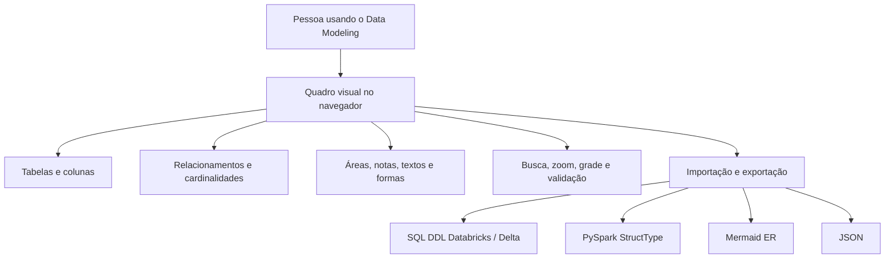
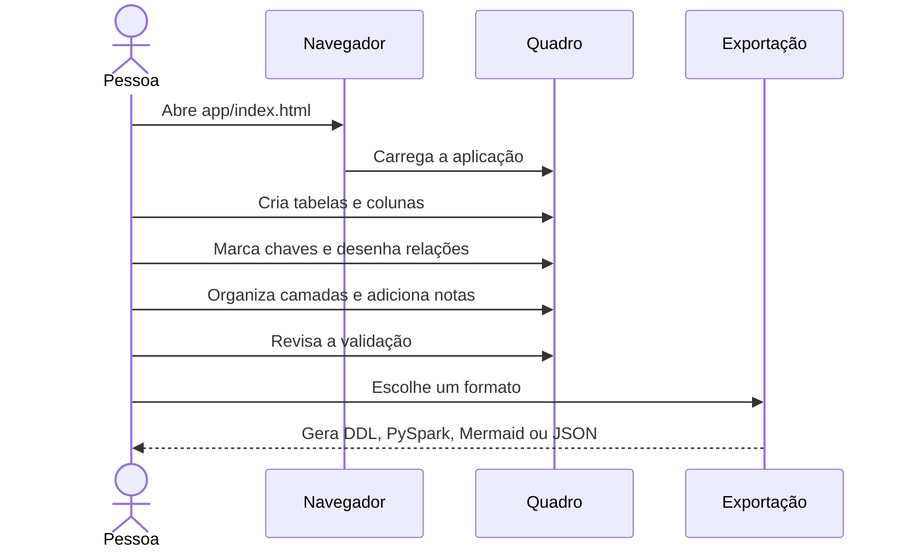
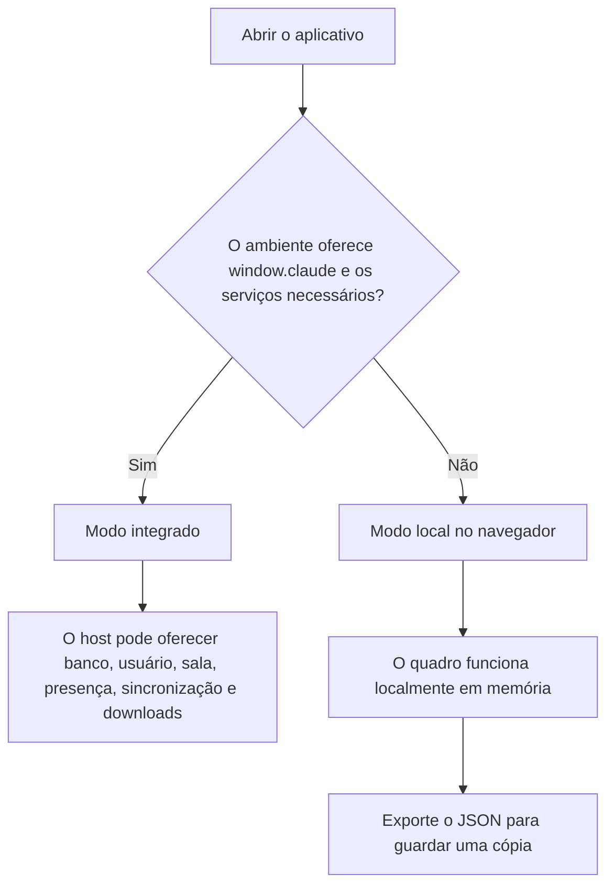

# Como o Data Modeling funciona

Este documento explica, sem entrar em detalhes desnecessários de programação, o que acontece quando alguém usa o Data Modeling.

## 1. A ideia principal

O aplicativo abre no navegador e apresenta um quadro de modelagem. Nesse quadro, a pessoa adiciona tabelas, colunas, relacionamentos e outros elementos visuais. Depois, pode revisar o desenho e exportar as informações em diferentes formatos.

A aplicação principal está em `app/index.html`. É um arquivo que reúne a interface, os estilos e o código JavaScript responsável pelo comportamento.

## 2. O que fica representado no quadro

| Elemento | O que guarda ou representa |
|---|---|
| Tabela | Nome e conjunto de colunas. |
| Coluna | Nome, tipo, descrição e marcações de chave. |
| Relacionamento | Ligação entre colunas e cardinalidade. |
| Área/frame | Agrupamento visual de partes do modelo. |
| Nota e texto | Explicações, regras e decisões. |
| Forma e conector | Elementos para complementar o desenho. |

O quadro também oferece recursos para navegar e editar: busca, zoom, grade, minimapa, seleção e desfazer/refazer.

## 3. Como uma pessoa usa o aplicativo

## 4. Os modos de execução

A aplicação verifica se foi aberta em um ambiente hospedeiro que disponibiliza `window.claude` e os serviços esperados.

### Modo local

Quando o arquivo é aberto diretamente em um navegador sem o ambiente hospedeiro, o quadro funciona em modo local. Não há armazenamento compartilhado nem garantia de salvamento automático. Para não perder o trabalho, exporte o JSON e guarde o arquivo.

### Modo integrado

Quando o ambiente hospedeiro fornece `window.claude` e os serviços `db`, `user`, `room` e `downloads`, o aplicativo pode usar os recursos disponibilizados por esse ambiente. A presença, a sincronização, a identidade e o controle de acesso dependem da implementação e da configuração do host.

Isso não significa que qualquer navegador ou qualquer instalação terá colaboração automaticamente.

## 5. Importação e exportação

A aplicação permite importar DDL e JSON. Também pode exportar o modelo em quatro formatos:

| Formato | Para que serve |
|---|---|
| SQL DDL Databricks / Delta | Definir estruturas de tabelas. |
| PySpark `StructType` | Representar os campos e tipos em código PySpark. |
| Mermaid ER | Incluir o diagrama em documentação compatível. |
| JSON | Guardar ou transportar o quadro para importação posterior. |

O JSON usa internamente o identificador `schema-board`, versão `1`. Esse identificador foi mantido para preservar a compatibilidade com arquivos existentes. O nome do produto e da aplicação é Data Modeling.

## 6. O que o aplicativo não executa

O Data Modeling é uma ferramenta de desenho e documentação. Nesta versão, ele não:
- executa comandos SQL;
- executa pipelines;
- consulta registros de tabelas;
- executa JOINs sobre dados;
- mostra uma prévia de linhas resultantes;
- cria tabelas finais a partir de transformações;
- se conecta diretamente a um workspace ou warehouse Databricks;
- calcula automaticamente a linhagem de dados ou de colunas.

O relacionamento que aparece no quadro descreve a estrutura. Ele não é uma operação de JOIN sendo executada.

## 7. Segurança e privacidade

O código inclui recursos de criptografia AES-GCM por meio da Web Crypto API e mecanismos de concessão e revogação de acesso no fluxo integrado. Mesmo assim, a segurança depende também do ambiente hospedeiro, do banco, da identidade, das permissões e da gestão das chaves.

O HTML sozinho não deve ser tratado como um serviço completo de autenticação ou armazenamento seguro. Revise os arquivos exportados antes de compartilhá-los, pois eles podem revelar nomes de tabelas, colunas, regras e decisões de arquitetura.
