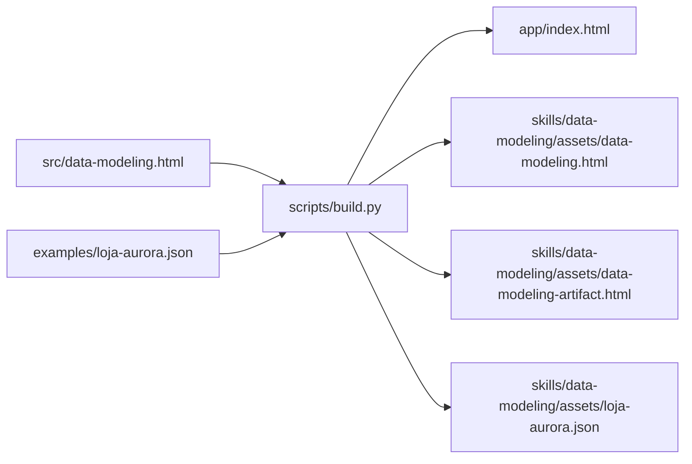

# Desenvolvimento

## Onde editar

| Você quer mudar… | Edite | Depois rode |
|---|---|---|
| O app (interface, atalhos, exportações) | `src/data-modeling.html` | `python scripts/build.py` |
| O exemplo fictício | `examples/loja-aurora.json` | `python scripts/build.py` |
| As instruções para o Claude e o Codex | `skills/data-modeling/SKILL.md` e `references/` | `python tests/validate_repo.py` |
| A instalação | `install.ps1`, `install.sh`, `uninstall.*` | testes abaixo |
| As imagens do README | — | `python scripts/screenshots.py` |

**Não edite à mão** `app/index.html` nem `skills/data-modeling/assets/*`: eles são gerados pelo `build.py` e o CI falha se estiverem desatualizados.



O fonte é um *fragmento* (sem `<html>`/`<body>`), que é o formato aceito pelo artefato do Claude. O `build.py` embute o exemplo no lugar do marcador `/*@@DEMO_BOARD@@*/null` e gera também a versão de documento completo para abrir no navegador.

## Testes

```bash
pip install playwright && python -m playwright install chromium

python scripts/build.py --check   # arquivos gerados em dia
python tests/validate_repo.py     # skill, plugin, versão, exemplo, instaladores, README
python tests/test_smoke.py        # abre o app num navegador real e exercita o básico
```

Antes de publicar, confira também se nenhum termo privado escapou:

```bash
DATA_MODELING_PROIBIDOS="nome-da-empresa,nome-interno" python tests/validate_repo.py
```

Para testar a instalação sem mexer na sua máquina, use uma pasta pessoal falsa:

```bash
HOME=/tmp/casa-falsa CODEX_HOME=/tmp/casa-falsa/.codex bash install.sh --no-open
HOME=/tmp/casa-falsa CODEX_HOME=/tmp/casa-falsa/.codex bash uninstall.sh --all
```

## Nova versão

1. Atualize `VERSION`, `.claude-plugin/plugin.json`, `.claude-plugin/marketplace.json`, `CITATION.cff` e `skills/data-modeling/SKILL.md` se necessário.
2. Escreva a seção `## [x.y.z]` no `CHANGELOG.md`.
3. Rode os testes, faça o merge na `main` e crie a tag `vx.y.z`. O workflow **Release** publica o zip da skill, o HTML e o exemplo.
