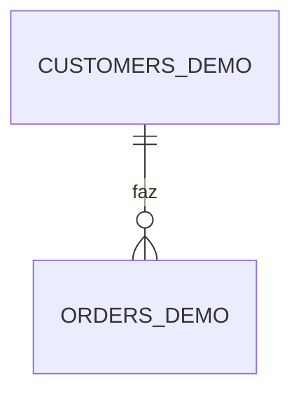
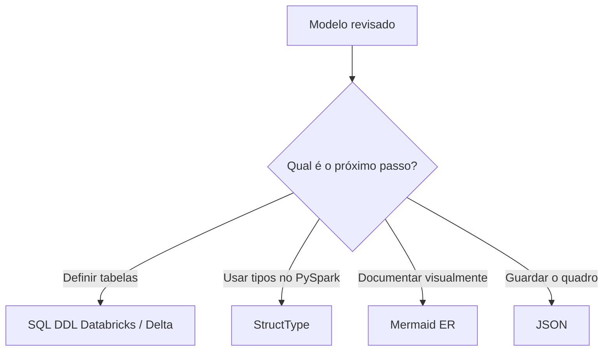

# Guia prático de uso do Data Modeling

Este guia é para quem quer começar a usar o Data Modeling sem precisar conhecer todos os conceitos de modelagem de dados. A proposta é ir por partes: entender o que precisa ser representado, montar as tabelas, conectar tudo e revisar o resultado.

## 1. Antes de criar qualquer tabela

Primeiro, responda:

- Qual assunto ou processo eu quero representar?
- Quais informações preciso organizar?
- Quem vai consultar ou entender esse modelo?
- O que cada linha de cada tabela representa?

Essa última pergunta é muito importante. Em modelagem de dados, ela é chamada de **grão**.

Exemplos:
- Uma linha por cliente.
- Uma linha por pedido.
- Uma linha por produto.
- Uma linha por item de pedido.

Se uma tabela mistura mais de um grão sem uma regra clara, fica mais difícil entender os dados e os relacionamentos.

## 2. Comece pelas tabelas principais

Crie primeiro as tabelas que representam os assuntos centrais. Não precisa preencher todos os detalhes de uma vez.

Exemplo fictício:

| Tabela | O que representa | Grão |
|---|---|---|
| `customers_demo` | Clientes de demonstração | Uma linha por cliente |
| `orders_demo` | Pedidos de demonstração | Uma linha por pedido |
| `products_demo` | Produtos de demonstração | Uma linha por produto |

Depois, adicione as colunas. Para cada coluna, procure informar:
- Nome que seja fácil de entender.
- Tipo de dado esperado.
- Descrição do que aquele campo representa.

## 3. Entenda as chaves

As chaves ajudam a identificar registros e mostrar como as tabelas se conectam.

- **PK (Primary Key / chave primária):** campo ou conjunto de campos que identifica um registro dentro da tabela.
- **FK (Foreign Key / chave estrangeira):** campo que aponta para uma chave de outra tabela e representa uma relação.

Exemplo:

```text
customers_demo
┌──────────────────────────┐
│ PK customer_id           │
│    customer_name         │
└────────────┬─────────────┘
             │
             │ customer_id
             │
┌────────────▼─────────────┐
│ orders_demo              │
│ PK order_id              │
│ FK customer_id           │
│    order_date            │
└──────────────────────────┘
```

Nesse exemplo, `customer_id` identifica o cliente em `customers_demo` e aparece em `orders_demo` para indicar a qual cliente cada pedido está associado.

## 4. Desenhe os relacionamentos

Depois de marcar as chaves, conecte as tabelas. A cardinalidade explica quantos registros de um lado podem estar relacionados com registros do outro.

Um exemplo comum:



A leitura é: um cliente pode ter nenhum ou vários pedidos. A regra precisa fazer sentido para o cenário que você está modelando; não escolha a cardinalidade apenas porque o desenho parece melhor.

## 5. Organize o quadro para facilitar a leitura

O Data Modeling tem elementos que ajudam a deixar o desenho mais claro:

- **Áreas/frames:** separam partes do modelo.
- **Notas:** registram regras, dúvidas e decisões.
- **Textos:** dão título e contexto para cada parte.
- **Formas e conectores:** ajudam a explicar etapas e fluxos.
- **Grade e minimapa:** ajudam a posicionar e localizar elementos.
- **Zoom e busca:** facilitam trabalhar em quadros maiores.

Tente manter as tabelas relacionadas próximas umas das outras e evite cruzar muitas linhas. O objetivo é que outra pessoa consiga acompanhar o desenho sem precisar de uma explicação longa.

## 6. Use as camadas com um padrão

A ferramenta oferece opções como `raw`, `bronze`, `silver`, `gold`, `stage`, `dim`, `fact` e entidade.

Use essas opções para indicar o papel de cada tabela na arquitetura que você está desenhando. Se o seu time tiver uma convenção diferente, registre essa regra em uma nota. Assim, todos entendem o que cada camada significa naquele modelo.

## 7. Revise antes de exportar

Antes de considerar o modelo pronto, faça uma revisão:

- Os nomes das tabelas e colunas são claros?
- O grão de cada tabela está definido?
- Os tipos de dados fazem sentido?
- As PKs identificam os registros como esperado?
- As FKs apontam para as colunas corretas?
- As cardinalidades representam a regra do cenário?
- As notas explicam as decisões importantes?
- Os alertas da validação foram analisados?

A validação ajuda a encontrar pontos que merecem atenção, mas não substitui a análise de quem conhece a regra de negócio.

## 8. Escolha o formato de exportação



- **SQL DDL:** gera definições de estruturas de tabelas. Revise antes de executar.
- **PySpark `StructType`:** representa os campos e seus tipos no código.
- **Mermaid ER:** permite inserir o diagrama em documentação que aceite Mermaid.
- **JSON:** guarda os elementos do quadro para importar novamente.

Lembre-se: o SQL exportado é DDL. Ele não é uma consulta `SELECT`, não executa JOIN e não cria uma tabela com dados transformados.

## 9. Uma forma simples de trabalhar

```text
OBJETIVO
   ↓
TABELAS
   ↓
COLUNAS E TIPOS
   ↓
PKs E FKs
   ↓
RELACIONAMENTOS
   ↓
CAMADAS E NOTAS
   ↓
VALIDAÇÃO
   ↓
EXPORTAÇÃO
```

É melhor fazer esse processo em ciclos pequenos. Monte uma primeira versão, peça para alguém revisar, corrija o que for necessário e só depois gere os arquivos para compartilhar.

## 10. Cuide do arquivo do seu modelo

Quando o aplicativo é aberto diretamente no navegador, sem o ambiente hospedeiro compatível, o quadro funciona em memória e não tem salvamento automático garantido. Nesse caso, exporte o JSON sempre que quiser guardar uma versão do trabalho.

Antes de compartilhar esse arquivo, confira se ele não contém nomes internos, informações pessoais, regras confidenciais ou detalhes da arquitetura da empresa.

## 11. O que esta ferramenta não faz

O Data Modeling documenta a estrutura. Nesta versão, ele não consulta dados reais, não executa JOINs, não mostra linhas resultantes, não executa pipelines e não se conecta diretamente ao Databricks. Para essas atividades, use as ferramentas de execução apropriadas.
