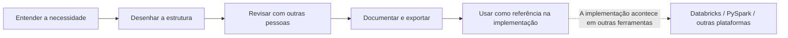

# Sobre o Data Modeling

## Por que eu criei este projeto

Eu queria uma forma mais simples de visualizar e explicar como as tabelas de um modelo de dados se conectam. Muitas vezes, a estrutura fica espalhada em SQL, planilhas e anotações. Isso dificulta enxergar o conjunto e explicar as decisões para outra pessoa.

O Data Modeling reúne essas informações em um quadro visual. A ideia é que eu consiga montar o desenho da estrutura, organizar as tabelas, mostrar os relacionamentos e deixar as explicações junto do próprio modelo.

## Para quem ele pode ser útil

- Para quem está aprendendo modelagem de dados e quer visualizar os conceitos.
- Para analistas e engenheiros de dados que precisam planejar ou revisar estruturas.
- Para quem trabalha com Databricks, Delta Lake ou PySpark e quer documentar schemas.
- Para equipes que precisam discutir uma arquitetura antes de implementá-la.
- Para quem precisa explicar um modelo técnico de uma forma mais visual.

## O que a versão atual oferece

Hoje, a ferramenta permite criar tabelas e colunas, definir tipos e descrições, marcar PK e FK, desenhar relacionamentos e indicar cardinalidades. Também é possível organizar o quadro por camadas, adicionar áreas, notas, textos, formas e conectores, usar recursos de navegação e validar o modelo.

A aplicação importa DDL e JSON e exporta SQL DDL Databricks/Delta, PySpark `StructType`, Mermaid ER e JSON.

## Como ela se encaixa no trabalho com dados

O Data Modeling ajuda a planejar e documentar. A execução de consultas, transformações e pipelines continua sendo feita nas ferramentas próprias para essas atividades.

## O que eu quero desenvolver no futuro

Uma das ideias é evoluir a ferramenta para também ajudar a desenhar transformações, especialmente JOINs. Isso poderia incluir a escolha do tipo de JOIN, as condições de relacionamento, uma prévia com dados fictícios, a geração de SQL `SELECT` e uma visualização da linhagem.

Essas ideias estão no roadmap. Não fazem parte da versão atual.

## O que orienta o projeto

- Deixar a modelagem mais fácil de entender e explicar.
- Manter a aplicação simples de abrir e usar.
- Ser claro sobre o que já funciona e o que ainda é plano.
- Usar dados fictícios nos exemplos públicos.
- Preservar a compatibilidade dos modelos JSON existentes.
- Manter a documentação alinhada ao comportamento real do aplicativo.
